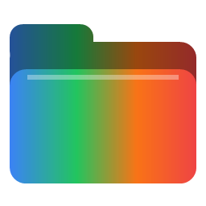
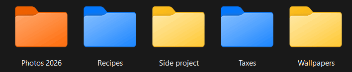
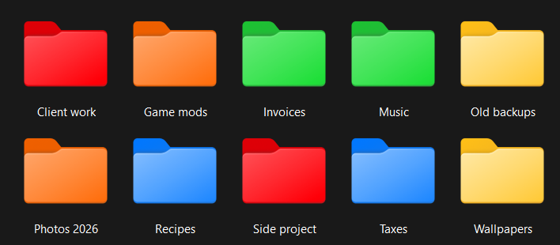
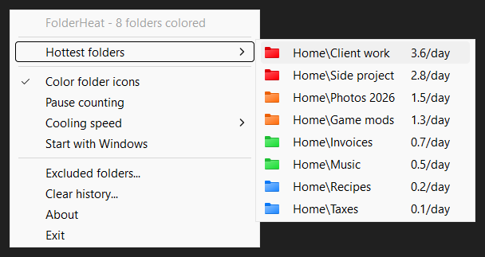

<!-- AI setup by iAlturki -->
<p align="center">
  
  &nbsp;&nbsp;
  <a href="https://ialturki.github.io/FolderHeat/agent-setup/"></a>
</p>
<p align="center"><sub>Click the setup button, copy the prompt, and give it to your AI agent. <a href="docs/agent-setup/prompt.txt">Read the prompt</a>.</sub></p>
<!-- /AI setup by iAlturki -->

# FolderHeat

🔥 Folder icons that show how often you open them. Every folder you open in File Explorer warms up from **blue** to **green**, **orange** and **red**, and cools back down to the normal icon when you stop using it. One small `.exe` in the tray, no installer, no dependencies.

[](https://github.com/iAlturki/FolderHeat/releases/latest/download/FolderHeat.exe)



| In Explorer | Tray menu |
|:-:|:-:|
|  |  |

## What the colors mean

| Color | You open the folder about |
|:-:|---|
| 🟦 Blue | once a week or more |
| 🟩 Green | every other day or more |
| 🟧 Orange | more than once a day |
| 🟥 Red | three times a day or more |

Visits fade with a half-life (two weeks by default), so the colors follow what you use *now*. A brand-new folder gets there faster: with the default setting, 3 opens turn it blue, about 10 green, 25 orange and 52 red. A folder you stop opening drops a tier at a time and ends up with the normal icon again.

## Features

- **Real folder icons, recoloured.** The tiers are made on your PC from the folder icon that ships with your Windows: the hue changes and the shading stays, so a red folder still looks like a Windows folder in every view, from *Details* to *Extra large icons*.
- **Counts what you actually open.** Each time an Explorer window or tab shows a folder it wasn't showing before, that's one visit: double-clicking, the address bar, Back, Quick access, a new tab.
- **Cools down by itself.** *Cooling speed* sets the half-life: Fast (1 week), Normal (2 weeks) or Slow (1 month).
- **Hottest folders** in the tray menu, each with its colour and estimated visits per day. Click one to open it.
- **Leaves alone what isn't its business.** Folders that already have a custom icon (Desktop, Documents, Downloads, anything you customised), drive roots, Windows, Program Files, ProgramData, OneDrive, removable and network drives are never touched. Add your own folders under **Excluded folders…**.
- **Git-friendly.** A `desktop.ini` inside a git repository would show up as an untracked file, so FolderHeat lists it in that repo's local `.git/info/exclude`, which is never committed.
- **Undo is one click.** Untick **Color folder icons** and every icon goes back to normal, along with the files and attributes FolderHeat added.
- **Pause counting**, **Start with Windows**, **Clear history**. Single instance, and the tray icon survives Explorer restarts.

## Installation

1. Download `FolderHeat.exe` from [Releases](../../releases)
2. Run it. A folder icon appears in your system tray
3. (Optional) right-click it → **Start with Windows**

Then just use Explorer as usual.

> **Antivirus / SmartScreen:** FolderHeat is a small **unsigned** indie executable, so SmartScreen may show an "unknown publisher" prompt the first time: click **More info → Run anyway**. Release builds are made by GitHub Actions with MSVC and the static C runtime, and every release lists the SHA-256 of the exe.

## What it changes on your PC

Being upfront about it, since it touches your folders:

- **In each coloured folder:** a hidden `desktop.ini` with one line, `IconResource=…\FolderHeat\icons\red-1.ico,0`, and the folder's read-only attribute (that's how Windows knows to read `desktop.ini`; it doesn't stop you writing to the folder). If the folder already had a `desktop.ini`, only that one line is added. Both are undone when the folder cools down or you untick **Color folder icons**.
- **In git repositories:** one `desktop.ini` line in `.git/info/exclude`.
- **Its own data:** `%LOCALAPPDATA%\FolderHeat` (visit history, the four icons, `exclude.txt`) and settings in `HKCU\Software\FolderHeat`. **Start with Windows** adds a `FolderHeat` value under `HKCU\…\CurrentVersion\Run`.

**To uninstall:** untick **Color folder icons**, choose **Exit**, then delete `FolderHeat.exe` and `%LOCALAPPDATA%\FolderHeat`.

## System requirements

- Windows 10 / 11
- One small executable, no dependencies, minimal CPU/RAM

## Build from source

Run `build.bat` (double-click it or run it from a terminal). It finds Visual Studio through `vswhere`, loads `vcvars64.bat`, and builds with MSVC and the static C runtime:

```bat
rc /nologo /fo app.res app.rc
cl /nologo /O2 /W3 /MT /D_CRT_SECURE_NO_WARNINGS /Fe:FolderHeat.exe main.c app.res ^
   user32.lib shell32.lib gdi32.lib advapi32.lib ole32.lib oleaut32.lib shlwapi.lib ^
   /link /SUBSYSTEM:WINDOWS /MANIFEST:NO
```

If Visual Studio isn't installed it falls back to MinGW-w64 (`windres`, then `gcc -O2 -municode -mwindows`). Releases use the MSVC build: unsigned MinGW GUI executables tend to trip antivirus heuristics.

## How it works

- **Watching Explorer without polling it.** A `SetWinEventHook` for name changes fires whenever something inside an Explorer window changes its title or caption, which navigating always does. A 350 ms debounce turns a burst of those into one scan, and the scan asks `IShellWindows` for every window and tab, then walks `IShellBrowser` → `IFolderView` → `IPersistFolder2` to the folder each one shows. A folder that is now on screen in more windows or tabs than at the last scan has been visited.
- **Heat with a half-life.** Each visit adds 1 to a folder's score, and the score halves every *H* days. A folder opened *k* times a day settles at *k* / (1 − 0.5^(1/*H*)), so multiplying back by that factor gives the visits-per-day estimate the tiers and the menu use.
- **Icons.** On first run the stock folder icon (`SHGetStockIconInfo`) is extracted at ten sizes from 16 to 256 px, every coloured pixel is moved to the tier's hue in HSL while keeping its lightness, and the result is written as four `.ico` files. A folder gets its colour through `SHGetSetFolderCustomSettings`, the documented shell API for a folder's custom icon, so Explorer treats it like any icon you'd pick by hand.
- **A bug caught before release.** Turning colours off for several folders at once sent one change notification per folder, and Explorer sometimes merged them and kept showing one stale orange folder. Notifications are now synchronous (`SHCNF_FLUSH`), and on/off/on cycles redraw every folder.

| File            | Purpose                                                |
|-----------------|--------------------------------------------------------|
| `main.c`        | Everything: Explorer watching, heat, icons, tray       |
| `resource.h`    | Resource / menu-command ids                            |
| `app.rc`        | Icon, manifest and version resources                   |
| `app.manifest`  | DPI awareness (PerMonitorV2) + Common Controls v6      |
| `icon.ico`      | App / tray icon                                        |
| `build.bat`     | One-click build: MSVC if installed, else MinGW         |

## License

CC BY-NC-SA 4.0 © 2026 iAlturki. See [LICENSE](LICENSE), [NOTICE](NOTICE), and [AUTHORS](AUTHORS). If you fork or redistribute, keep the copyright notice and attribution intact.


Current original material is **CC BY-NC-SA 4.0 © iAlturki**. Earlier MIT releases retain their original terms; third-party material retains its own notices. See [NOTICE](NOTICE) and [LICENSES/previous-MIT.txt](LICENSES/previous-MIT.txt).
